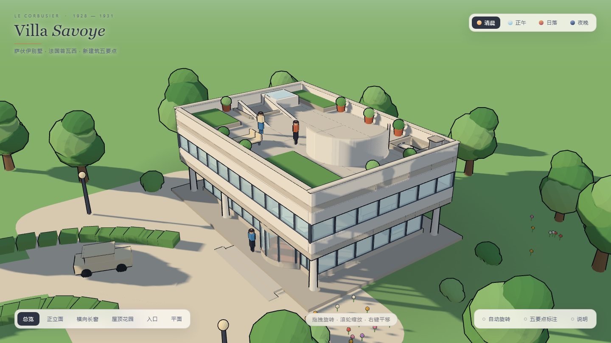
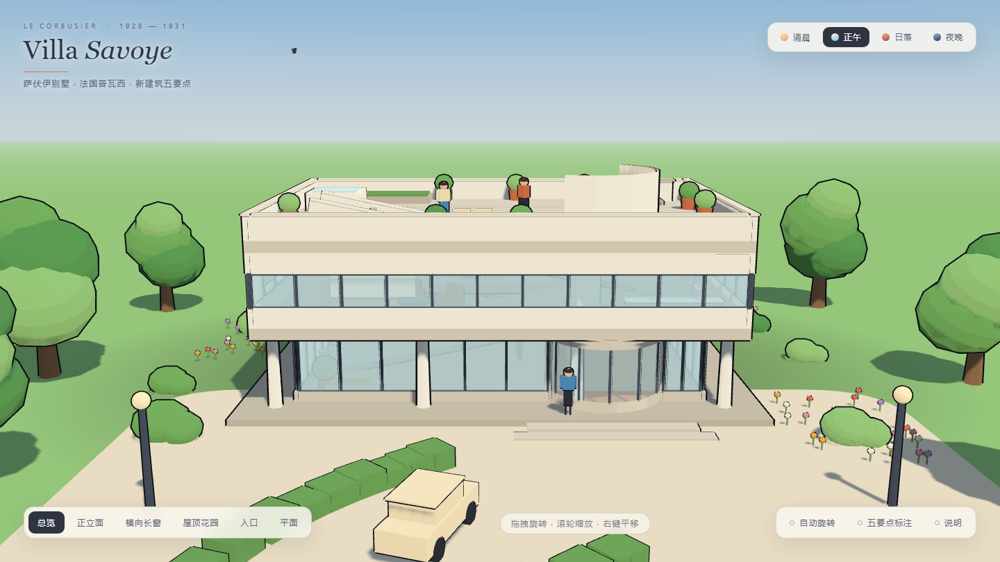
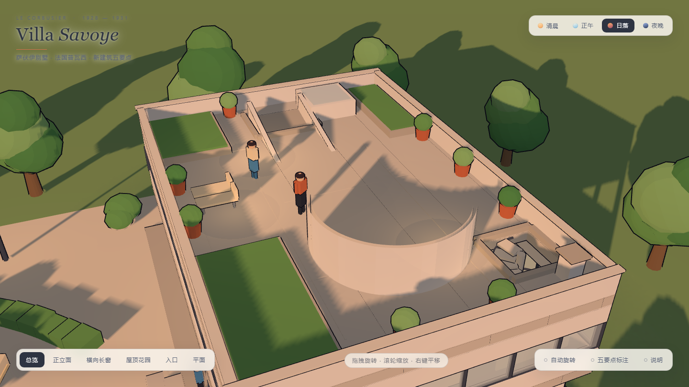
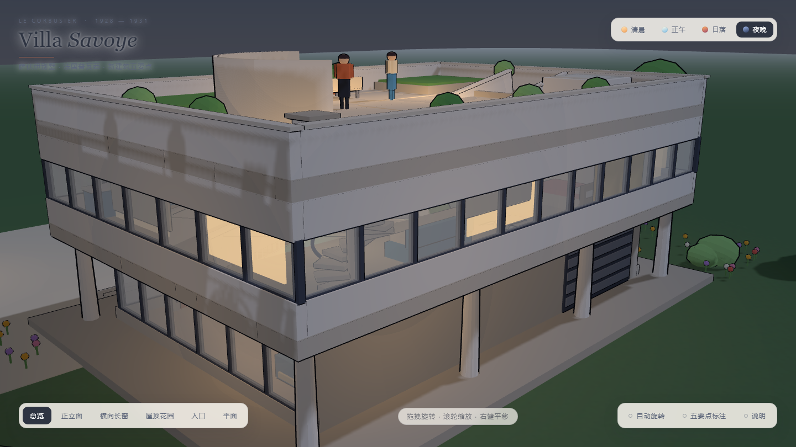
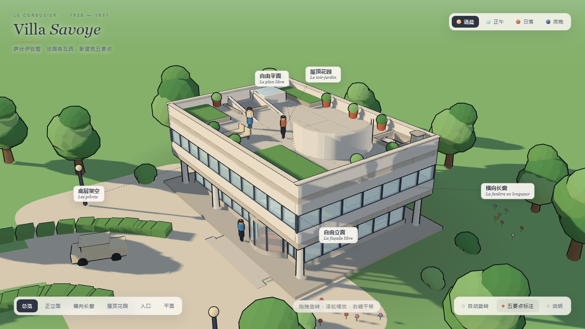

# Villa Savoye · 萨伏伊别墅

**勒·柯布西耶「新建筑五要点」的可交互三维再现 —— 精致卡通风，单文件网页，零依赖。**

以 Three.js 手工建模的 [萨伏伊别墅](https://zh.wikipedia.org/wiki/%E8%90%A8%E4%BC%8F%E4%BC%8A%E5%88%AB%E5%A2%85)（Villa Savoye, 1928–1931, 法国普瓦西），
按真实比例重建了底层架空、横向长窗、自由平面、屋顶花园与自由立面，并做成一个可以直接双击打开的网页。

> **在线预览：<https://nyan936.github.io/villa-savoye/>**



---

## 目录

- [预览](#预览)
- [场景内容](#场景内容)
- [交互](#交互)
- [快速开始](#快速开始)
- [项目结构](#项目结构)
- [实现要点](#实现要点)
- [质量校验](#质量校验)
- [关于这座房子](#关于这座房子)
- [许可](#许可)

---

## 预览

| 正立面 · 五要点 | 屋顶花园 |
|---|---|
|  |  |

| 夜幕降临，室内亮灯 | 五要点标注 |
|---|---|
|  |  |

---

## 场景内容

不是简单的方盒子，而是按建筑构件逐件搭建：

**底层架空 Les pilotis**
- 8 根细柱把白色方盒托起，柱网位于体量外缘
- 底层墙面后退 1.3 m，形成通透的玻璃亭：东、西、南三面通高玻璃幕，北面实墙开卷帘车库门
- 室内停着两辆车，可透过玻璃看到中央螺旋楼梯与贯穿的坡道

**自由平面 Le plan libre + 横向长窗 La fenêtre en longueur**
- 二层四周为连续带状长窗（浅蓝玻璃 + 深色窗梃 + 米色卷帘），上下为自由立面的白色薄墙
- 室内：贯穿全层的坡道、螺旋楼梯、弧形隔墙、卧室、厨房、LC2 扶手椅、地毯
- 楼板开洞让坡道与楼梯真正贯通上下层

**屋顶花园 Le toit-jardin**
- 弧形日光浴墙、种植池、8 个陶盆绿植、躺椅、天窗、通气管
- 坡道破屋面而出，洞口有混凝土翻边收口；螺旋梯井同样有翻边
- 女儿墙带白色压顶与铺装分格缝

**场地**
- 低多边形树木、绿篱、花丛、车道、前庭、入口台阶、路灯
- 飘云、飞鸟、白色小人点缀

---

## 交互

| 操作 | 功能 |
|---|---|
| 拖拽 / 滚轮 / 右键拖拽 | 旋转 · 缩放 · 平移（带阻尼惯性） |
| 清晨 · 正午 · 日落 · 夜晚 | 四套光环境平滑过渡；日落起路灯与室内灯自动点亮，夜晚有星空 |
| 总览 / 正立面 / 横向长窗 / 屋顶花园 / 入口 / 平面 | 六个电影式运镜预设 |
| 五要点标注 | 引出线标注五项要点 |
| 说明 | 建筑与五要点介绍面板 |

**快捷键**：`1`–`4` 切换光线 · `R` 自动旋转 · `A` 五要点标注 · `I` 说明面板

---

## 快速开始

### 直接看

双击 `index.html` 即可。**单文件、完全离线**（Three.js 已内联，无任何外部请求）。

### 从源码构建

只需要 Node.js，没有任何 npm 依赖：

```bash
node build.mjs
# built index.html 722 KB
# built Villa-Savoye.html 722 KB
```

构建 = 把 `vendor/three.min.js` 和 `src/scene.js` 内联进 `src/page.html` 的模板里。

### 本地起服务（可选）

```bash
npx serve .
```

---

## 项目结构

```
.
├── index.html            # 构建产物 · 单文件网页（GitHub Pages 入口）
├── build.mjs             # 构建脚本：内联三方库与应用代码
├── src/
│   ├── page.html         # 页面骨架 + 全部 UI 样式（模板）
│   └── scene.js          # 3D 场景全部代码（约 1200 行）
├── vendor/
│   └── three.min.js      # Three.js r159 UMD（MIT）
├── tools/
│   └── capture.mjs       # 用 CDP 驱动 Chrome 截图 / 跑几何自检
└── docs/                 # README 配图
```

`src/scene.js` 分为若干段：渲染器与天空 → 材质与描边 → 日照与情绪（四套光环境）→ 建筑构件 → 场地与道具 → 室内灯 → 相机与交互 → 标注与 UI → 主循环。

---

## 实现要点

### 卡通质感的三层叠加

| 层 | 做法 |
|---|---|
| 明暗 | `MeshToonMaterial` + 5 级色阶梯度贴图，产生硬边分色而不是平滑渐变 |
| 墨线 | 反向描边 Shader：沿法线外扩壳体、`BackSide` 渲染，偏移量乘以视深，得到**屏幕空间等宽**的轮廓线 |
| 阴影 | PCF 软阴影 + 一张径向渐变贴图模拟建筑底部的接触阴影 |

### 四套光环境

清晨 / 正午 / 日落 / 夜晚各定义一组（太阳方向与色温、半球光、天空渐变三段色、雾、描边墨色、星空、室内灯强度），
切换时所有参数按指数平滑插值 —— 颜色用 `Color.lerp`、向量用 `Vector3.lerp`、数值线性插值。

天空是一个 420 半径的反面球，用 Shader 做三段渐变 + 太阳/月亮辉光；雾色与地平线颜色同步，让远处草地自然融入天空。

### 几何自检

场景里的闪烁几乎都来自「两块面片完全共面且法线同向」。为此写了两个注入页面的检查脚本（`tools/capture.mjs`）：

1. **共面同向检测** — 遍历所有轴对齐盒体，两两检测是否存在同一平面、同一朝向且面积重叠 > 0.02 m² 的面片对
2. **顶点侵入检测** — 把每个网格的每个顶点变换到世界坐标，检查是否落进 13 处墙体体块内部

修复前的基线是 **2014 处共面**，当前为 **0 处共面 / 0 处侵入**。

---

## 质量校验

```bash
node tools/capture.mjs "file:///.../index.html" shots.json
```

`capture.mjs` 用 Chrome DevTools Protocol 驱动无头 Chrome：可注入任意 JS、等待、截图。
当前结果：

```
axisBoxes=243   coplanarSameFacing=0   wallIntruding=0
```

---

## 关于这座房子

萨伏伊别墅（Villa Savoye）位于法国普瓦西，1928 年由**勒·柯布西耶**与**皮埃尔·让纳雷**设计，1931 年建成，
是国际式风格与现代主义建筑最著名的宣言之一。它把柯布西耶的「新建筑五要点」第一次完整地实现出来：

1. **底层架空** Les pilotis — 房屋被细柱托起，底层归还给花园与车行
2. **屋顶花园** Le toit-jardin — 平屋顶成为空中花园，找回被建筑占去的绿地
3. **自由平面** Le plan libre — 承重与围护分离，隔墙可自由布置
4. **横向长窗** La fenêtre en longueur — 带状长窗让光线与风景横向展开
5. **自由立面** La façade libre — 外墙不再承重，成为一层轻薄的皮

本项目是对这座建筑的**独立三维诠释**，用于学习与展示；建筑本身的设计著作权属于其权利人。

---

## 许可

代码以 [MIT](LICENSE) 许可发布。
内置的 [Three.js](https://threejs.org/) r159 同样为 MIT 许可（见 `vendor/README.md`）。
